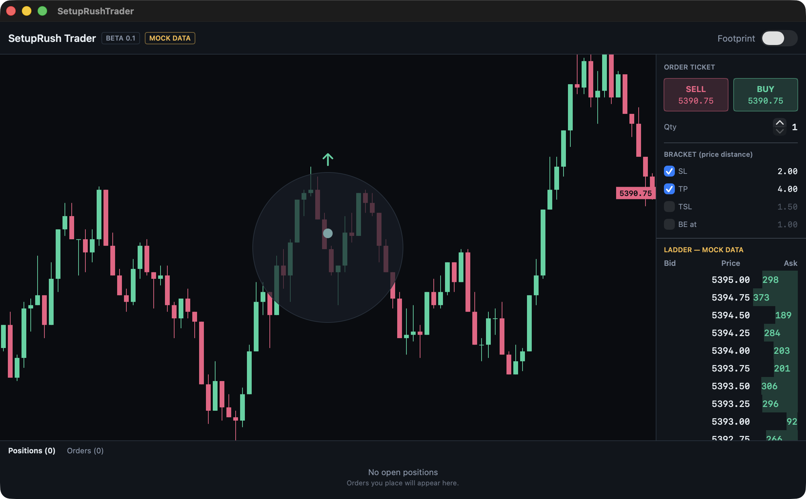

# SetupRush Trader

**Beta 0.1** — a native macOS SwiftUI trading-terminal prototype, built against a
mock gateway ahead of a real [cTrader](https://ctrader.com) MCP connection.



> All prices, order-flow and order-book data on screen are synthetic (clearly
> labeled **MOCK DATA** in the header). There is no real market connection, no
> account, and no real money at risk — this is a UI/UX prototype.

## What's in this build

- **Chart**: candlestick rendering, pinch-to-zoom anchored at the pinch point, pan
- **Footprint / order-flow view**: Bid×Ask and Delta display modes, with a
  zoomed-in numeric tier (bid/ask/delta per price level) built on the causal
  bid/ask-split construction from the DeltaTrader order-flow playbook
- **Order ticket**: Buy/Sell, quantity, and a full SL / TSL (trailing stop) / TP /
  BE (breakeven) bracket
- **Synthetic DOM ladder** with heat-bars, clearly labeled as mock
- **Positions/Orders dock** with honest empty states — positions are never
  fabricated; they only appear from your own simulated trades
- **Two execution paths**:
  - keyboard (`B`/`S` + Return) or ticket buttons, with an arm-then-confirm banner
  - a trackpad two-finger **pull-to-arm gesture**: a center ring with a knob that
    blends from grey to green/red as you pull, and a directional arrow outside
    the ring — release past the ring to submit, release inside it to cancel
- **Simulated position lifecycle**: a local random-walk price ticker resolves
  SL/TP/TSL/BE in real time, so brackets are actually demoable, ending with a
  floating **+€ / -€** close alert. This simulation is explicitly flagged in code
  to be disabled once a real market/gateway connection exists.

See [`BACKLOG.md`](BACKLOG.md) for the full feature gap analysis against the
product spec and a prioritized roadmap, and
[`SETUPRUSH_TRADER_PROJECT_SPEC.md`](SETUPRUSH_TRADER_PROJECT_SPEC.md) for the
full product/UX/trading requirements this prototype is working toward.

## Running it

Grab the latest `.app` from [Releases](../../releases), or build from source:

```bash
swift build
.build/debug/SetupRushTrader
```

To package a real `.app` bundle (for dragging to the Dock):

```bash
AppPackaging/make_app.sh
```

Requires macOS 14+.

## Disclaimer

This is a prototype trading-UI client, not a broker and not financial advice.
No live trading, no real account connection, no real money.
